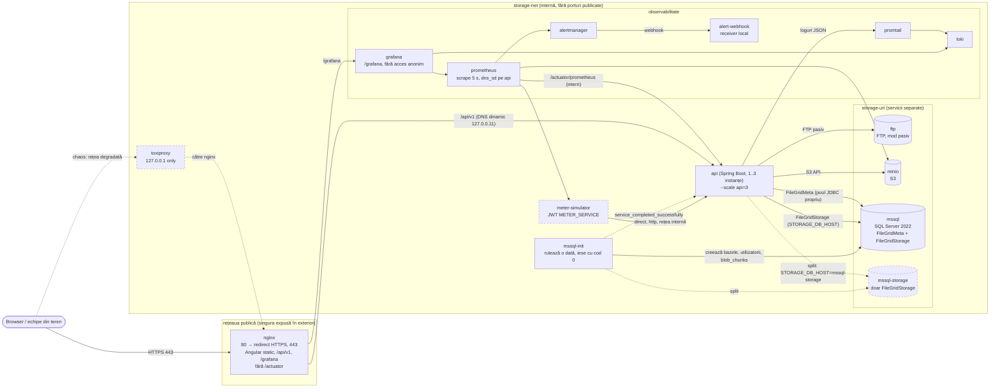

# Arhitectura FileGrid PPC

Diagrama serviciilor din Docker Compose (planul v4, secțiunile 4 și 4.1). Pornește cu o singură comandă din rădăcina
repo-ului: `./scripts/start.sh` (Linux/macOS/WSL) sau `.\scripts\start.ps1` (Windows). `docker-compose.yml` din rădăcină
include `infra/docker/docker-compose.yml`.

## Diagrama serviciilor

Notație: linia punctată = opțional (profil `split`, `chaos` sau `sim`) sau dependență de pornire. Din exterior se vede
doar `nginx`; nicio altă componentă nu publică porturi în `docker-compose.yml` (vezi „Porturi” mai jos).

## Rețele

| Rețea | Tip | Cine e conectat | Rol |
|---|---|---|---|
| `public` | bridge, cu porturi publicate | `nginx` (80, 443); `toxiproxy` doar în profilul `chaos`, publicat pe `127.0.0.1` | singura intrare din exterior |
| `storage-net` | `internal: true`, fără porturi publicate | `nginx` (ca să ajungă la `api` și `grafana`), `api`, `mssql`, `mssql-init`, `mssql-storage`, `minio`, `ftp`, `prometheus`, `alertmanager`, `alert-webhook`, `loki`, `promtail`, `grafana`, `meter-simulator`, `toxiproxy` | storage-urile și observabilitatea nu sunt accesibile din afara sistemului |

Planul fixează două rețele (internă `storage-net` și publică doar pentru `nginx`); serviciile de observabilitate stau
pe `storage-net`, iar Grafana se vede din exterior doar prin `nginx`, la `/grafana`.

## Servicii și profiluri

| Serviciu | Profil | Rol | Volum persistent |
|---|---|---|---|
| `nginx` | implicit | TLS (certificat self-signed generat la prima pornire), Angular static, proxy către `api`, `/grafana` | `nginx-certs` |
| `api` | implicit | aplicația Spring Boot; pornește abia după `mssql-init` (`service_completed_successfully`) | – (nimic din upload pe discul instanței) |
| `mssql` | implicit | un singur container SQL Server cu bazele `FileGridMeta` și `FileGridStorage` | `mssql` |
| `mssql-init` | implicit | creează bazele, cei doi utilizatori cu drepturi minime și `blob_chunks`; idempotent | – |
| `minio` | implicit | storage S3 | `minio` |
| `ftp` | implicit | storage FTP (porturi pasive doar în rețeaua internă) | `ftp` |
| `prometheus` | implicit | colectare la 5 s, `dns_sd_configs` pe `api` (o țintă per instanță) | `prometheus` |
| `grafana` | implicit | dashboard-uri provisionate, la `/grafana` | `grafana` |
| `loki` | implicit | loguri JSON | `loki` |
| `promtail` | implicit | trimite logurile `api` către Loki | – |
| `alertmanager` | implicit | 4 alerte de business, `group_wait: 10s` | – |
| `alert-webhook` | implicit | receiver local pentru alerte | – |
| `meter-simulator` | `sim` | simulator de contoare (`docker compose --profile sim up`) | – |
| `toxiproxy` | `chaos` | rețea degradată, portul publicat doar pe `127.0.0.1` | – |
| `mssql-storage` | `split` | opțional: al doilea SQL Server, doar pentru `FileGridStorage` (`STORAGE_DB_HOST=mssql-storage`) | `mssql-storage` |

`docker compose down -v` șterge volumele numite (resetarea demo-ului). Numele `nginx-certs` și `mssql-storage` pentru
volume sunt alese aici; planul enumeră doar `mssql`, `minio`, `ftp`, `grafana`, `prometheus` și `loki`.

## Porturi

| Port | Unde | Observație |
|---|---|---|
| 80, 443 | `nginx` | 80 redirecționează la HTTPS; singurele porturi publice implicite |
| toxiproxy | `127.0.0.1` | doar profilul `chaos` |
| 1433 și alte porturi interne | `127.0.0.1` | doar în `infra/docker/docker-compose.dev.yml` (activat explicit cu `-f`), de exemplu SQL Server pentru SSMS |

`/actuator` nu este proxiat de `nginx` și rămâne doar pe rețeaua internă (folosit de Prometheus).

## Stocarea, pe scurt

| Categorie | Principal | Rezervă |
|---|---|---|
| METER_READING | DB | S3 |
| OUTAGE_RECORD | S3 | DB |
| CONNECTION_DOC | DB (criptat AES-GCM) | S3 |
| INSPECTION_VIDEO | FTP | S3 |

Politica e în `resources/policies/*.yml` și se recitește fără restart. Fiecare storage este folosit efectiv de cel puțin
o categorie, iar rezerva e mereu diferită de principal.

## Limite cunoscute

* Un singur container `mssql` este punct unic de cădere pentru metadate și pentru storage-ul DB. Decizia, limita și
  răspunsul pentru juriu: [ADR-001](../decisions/ADR-001-sql-server-punct-unic-de-cadere.md).
* Memorie (8 GB în Docker, buget țintă din planul v4): `mssql` 2,5 GB, `api` 3 × 512 MB, `minio` 512 MB,
  `prometheus` 512 MB, `loki` 512 MB, `grafana` 256 MB, `meter-simulator` 256 MB, restul ~600 MB (~7,1 GB). Se
  verifică la ora 8 cu `docker stats`.

Fluxurile principale: [fluxuri.md](fluxuri.md). Contractul API: [../api/openapi.yaml](../api/openapi.yaml).
