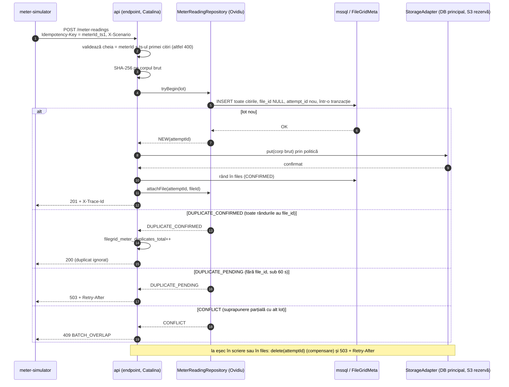
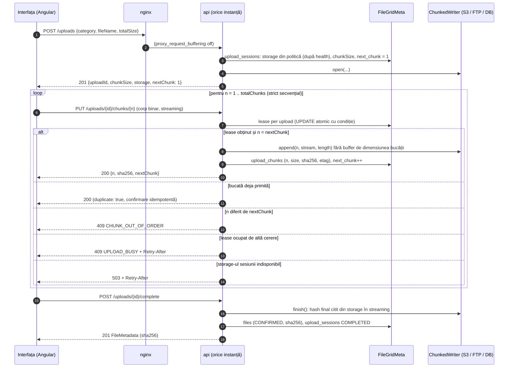
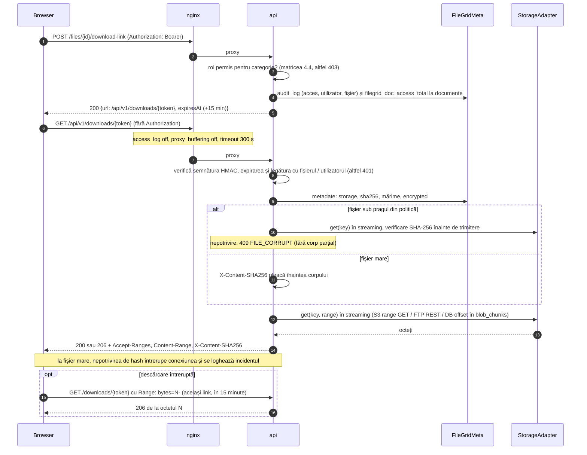

# Fluxurile principale

Trei fluxuri, așa cum sunt fixate în planul v4 (4.1) și în [openapi.yaml](../api/openapi.yaml). Diagramele arată
drumul normal; erorile și reîncercările sunt descrise sub fiecare.

## 1. Ingestia citirilor pe loturi (`POST /meter-readings`)

Un contor trimite un lot de 1–50 KB (implicit 96 de citiri). Fiecare citire e unică prin `(meter_id, reading_ts)`;
corpul brut se salvează și ca fișier `METER_READING`. Deduplicarea se face **înainte** de scrierea fișierului, ca
duplicatele să nu lase fișiere orfane.

Reguli care contează pentru Ovidiu și Flavius:

* **Erori SQL Server** 2627 și 2601 (`DuplicateKeyException`) marchează duplicatul; fără `IF NOT EXISTS` separat
  (curse de timp).
* Un lot „blocat” (rânduri fără `file_id`, mai vechi de 60 s) se preia cu un `UPDATE ... WHERE file_id IS NULL AND
  received_at < DATEADD(second,-60,SYSUTCDATETIME())` care setează noul `attempt_id`; cererea care vede exact numărul
  de rânduri așteptat devine proprietarul (`NEW`), celelalte primesc `PENDING`.
* Rândurile fără `file_id` mai vechi de 60 s înseamnă „citire neconfirmată” și alimentează
  `filegrid_meter_unconfirmed` (alerta 1).
* Clientul (simulatorul) reîncearcă la `429` / `503` cu **aceeași** cheie, până la 10 minute, apoi abandonează și
  numără (`sim_readings_abandoned_total`).
* Dacă `mssql` cade: `503` cu `Retry-After` pe ingestie; nimic confirmat nu se pierde (volum persistent) și
  contoarele retrimit.

## 2. Upload în bucăți, pe cele 3 storage-uri (`/uploads`)

Pentru fișiere mari (`INSPECTION_VIDEO`, 100 MB – 1 GB+). Bucățile se trimit strict secvențial, de la 1; starea este în
`upload_sessions` / `upload_chunks` (nimic pe discul instanței), deci orice instanță `api` poate continua un upload.

Cum se scrie fiecare storage (4.1):

| Storage | Cum se adaugă o bucată | La `complete` |
|---|---|---|
| S3 (MinIO) | multipart nativ; `UploadId` și ETag-urile în DB (de aceea `chunkSize` ≥ 5 MiB, validat de PolicyEngine) | `CompleteMultipartUpload` |
| FTP | un fișier per bucată, scris sub nume temporar și redenumit atomic (`RNFR` / `RNTO`) abia când e complet | manifest scris; la citire, adaptorul concatenează bucățile și calculează offset-urile pentru `Range` (`REST`) |
| DB | bucățile se adaugă în `blob_chunks` (`VARBINARY(MAX)`) | – |

Reluare și eșecuri:

* **Reîncercare**: aceeași bucată retrimisă e sigură (confirmare idempotentă); interfața folosește backoff
  exponențial până la 2 minute, iar `uploadId` stă în `sessionStorage`.
* **După refresh de pagină**: `GET /uploads/{id}` întoarce `nextChunk`; browserul nu mai are fișierul, deci interfața
  cere re-selectarea lui și verifică numele și mărimea înainte de reluare.
* **Storage-ul sesiunii cade**: bucățile primesc `503` + `Retry-After`; clientul reia după revenire. Dacă storage-ul
  nu revine în 10 minute sau clientul apelează `POST /uploads/{id}/abort`, sesiunea se abandonează, iar un upload nou
  alege storage-ul de rezervă (după health).
* **Sesiuni inactive peste 24 h**: se curăță automat (abort multipart S3, ștergerea bucăților FTP/DB).
* Detalii de decizie: [ADR-003](../decisions/ADR-003-upload-in-bucati.md).

## 3. Descărcarea cu link semnat

Browserul nu descarcă prin `fetch` în memorie. Rolul se verifică și accesul se auditează **la crearea link-ului**;
descărcarea propriu-zisă este nativă, în streaming și cu reluare (`Range`).

Particularități:

* **`CONNECTION_DOC`**: criptat AES-GCM pe segmente de 64 KiB, deci **fără `Range`** (răspuns `200` complet, fără
  `Accept-Ranges`). Se descarcă decriptat; `X-Content-SHA256` este `sha256Plain`. `/verify?deep=true` decriptează și
  verifică și `sha256Plain`. Numele original este criptat, iar `storage_key` este un UUID.
* **Link expirat sau invalid**: `401`. Linkul nu conține date personale, iar nginx nu loghează calea
  `/api/v1/downloads/` (token în cale).
* `/verify` rămâne calea principală pentru integritate: `409` „fișier corupt” (`FILE_CORRUPT`) la nepotrivire și
  `filegrid_integrity_failures_total++`.
* Detalii de decizie: [ADR-004](../decisions/ADR-004-descarcare-prin-link-semnat.md).

Vezi și [arhitectura.md](arhitectura.md) pentru servicii și rețele.
